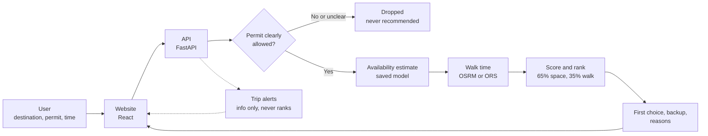
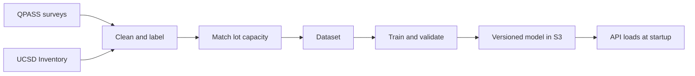
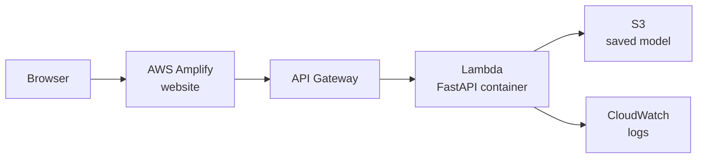

# ParkSmart

A UCSD parking recommendation tool. Enter a destination, permit type, and arrival time, and ParkSmart recommends a first-choice lot and a backup, with walk times and a short reason for each.

**Live demo:** https://demo.d2ru7u75tkpr69.amplifyapp.com

> **Note:** Results are estimates built from past UCSD parking surveys. They are not live availability and not a guaranteed space.

## Table of Contents

1. [Overview](#1-overview)
2. [System Architecture](#2-system-architecture)
3. [Repository Structure](#3-repository-structure)
4. [Key Design Decisions](#4-key-design-decisions)
5. [Setup and Local Run](#5-setup-and-local-run)
6. [Environment Configuration (.env)](#6-environment-configuration-env)
7. [Reproducing the Results](#7-reproducing-the-results)
8. [Deployment](#8-deployment)
9. [API Reference](#9-api-reference)
10. [Testing and Code Quality](#10-testing-and-code-quality)
11. [Limitations and Known Issues](#11-limitations-and-known-issues)
12. [Documentation Index](#12-documentation-index)
13. [Contributing](#13-contributing)
14. [Team](#14-team)

---

## 1. Overview

| Inputs | Outputs |
| --- | --- |
| Destination | First-choice lot and backup lot |
| Permit type (A, B, S, SR, D, V) | Up to 12 ranked options with reasons |
| Arrival time | Walk time for each lot |
| Optional: walk limit (up to 20 min), preference | Optional weather and construction notices |

**How a recommendation is made, in three steps:**
1. Keep only lots the permit clearly allows at that time.
2. Estimate how full each lot usually is, using historical survey data.
3. Rank lots by availability and walk time (default weighting: 65% availability, 35% walk).

---

## 2. System Architecture

### 2.1 Request path

What happens when a user presses Search.



### 2.2 Offline data pipeline

Runs before launch, never per request.



### 2.3 Hosting



---

## 3. Repository Structure

```text
parksmart/
├── src/                 Python backend (module guide below)
│   ├── api/             FastAPI app, schemas, Lambda entry point
│   └── trip_alerts/     Weather and construction notices
├── frontend/            React website (one-way copy, do not edit here)
├── tests/               Pytest suite, mostly one test file per module
├── infra/               AWS SAM template and Dockerfiles
├── config/              Location registry and label decisions
├── scripts/             dev.sh, check.sh, build_site.sh, sync_frontend.sh
├── docs/                Detailed guides (see Section 12)
├── notebooks/           Data exploration
├── results/, models/    Generated outputs (git-ignored)
└── .env.example         Configuration template
```

### Module guide

| Area | Files in `src/` | Purpose |
| --- | --- | --- |
| API | `api/main.py`, `schemas.py`, `saved_model.py`, `settings.py`, `lambda_handler.py` | Routes, validated inputs and outputs, model loading, config, AWS entry point |
| Decision engine | `eligibility.py`, `availability.py`, `ranking.py`, `recommender.py`, `routing.py` | Permit rules, availability estimate, scoring, final pick, walk time |
| Trip alerts | `trip_alerts/` (`weather.py`, `construction.py`, `service.py`, `cache.py`) | Optional context shown beside results |
| Data pipeline | `download_qpass.py`, `download_inventory.py`, `qpass_loader.py`, `clean_inventory*.py`, `labels.py`, `capacity_*.py`, `build_dataset.py` | Download, clean, label, match capacity, build the dataset |
| Modeling | `train_availability.py`, `prediction_experiments.py`, `prepare_prediction_artifact.py` | Train, compare, and package the model |
| Analysis | `parking_analysis.py`, `parking_benchmarks.py` | Exploration and baselines |

---

## 4. Key Design Decisions

| Decision | Rationale | Tradeoff |
| --- | --- | --- |
| Historical averages, not live counts | No validated live UCSD parking feed is connected | Cannot react to today's conditions |
| Permit rules filter first | A wrong lot can mean a ticket | Lots with unclear rules are hidden |
| Default ranking: 65% space, 35% walk | Finding a space matters more than a short walk | Users can switch to "shorter walk" or "more availability" |
| Free routing only (OSRM or ORS) | The project must not enable paid usage | Public OSRM has no uptime guarantee |
| Alerts never affect ranking | Weather and construction are not validated signals | Shown as extra context only |
| Data preparation is offline | Fast, predictable API startup | Model updates need a rebuild and release |

Further reading: [recommendations](docs/recommendations.md), [routing](docs/routing.md), [expert feedback](docs/expert_feedback_summary.md).

---

## 5. Setup and Local Run

**Requirements:** Python 3.11 or newer (3.12 matches the Lambda image), Node.js 20.19+ or 22.12+ (with npm), Git.

```bash
# 1. Clone and install
git clone https://github.com/yraclimaco/parksmart.git
cd parksmart
python3 -m venv .venv
source .venv/bin/activate
python -m pip install -r requirements.txt

# 2. Configure (see Section 6)
cp .env.example .env
set -a; source .env; set +a

# 3. Get data (public UCSD files, no key needed; build takes about 1 minute)
python -m src.download_qpass
python -m src.download_inventory
python -m src.build_dataset

# 4. Run backend and website together
scripts/dev.sh
```

| Service | URL |
| --- | --- |
| Website | http://localhost:3000 |
| API docs | http://127.0.0.1:8000/docs |

**Verify:** `GET /readiness` confirms the model loaded. `/health` only confirms the server is running.

---

## 6. Environment Configuration (.env)

ParkSmart has no `.env` loader. Copy the template and load it into your shell (Section 5, step 2). All variables are optional.

| Variable | Purpose | Default |
| --- | --- | --- |
| `PARKSMART_ROUTING_PROVIDER` | `ors`, `osrm`, or `none` (walk times off) | `ors` if a key is set, otherwise `osrm` |
| `ORS_API_KEY` | OpenRouteService key (free tier) | empty |
| `PARKSMART_CORS_ORIGINS` | Extra website origins allowed to call the API | localhost ports 3000 and 5173 |
| `PARKSMART_TRIP_ALERTS_ENABLED` | `false` turns off weather and construction calls | `true` |

`.env` is listed in `.gitignore`. Never commit keys, and never place one in a `VITE_` variable.

---

## 7. Reproducing the Results

Rebuild everything from raw public data:

```bash
python -m src.download_qpass
python -m src.download_inventory
python -m src.run_capacity_matching --rebuild-inventory
python -m src.build_dataset
python -m src.train_availability
python -m pytest -q
```

Serve the saved, reviewed model locally:

```bash
python -m uvicorn src.api.saved_model:create_saved_app --factory --reload
```

Guides: [pipeline](docs/pipeline.md), [capacity matching](docs/capacity_matching_summary.md), [model training](docs/issue18_predictions.md), [model releases in S3](docs/model_storage.md).

---

## 8. Deployment

| Component | Method | Guide |
| --- | --- | --- |
| Backend | Lambda container behind API Gateway, defined in `infra/template.yaml` | [infra/README.md](infra/README.md) |
| Website | `scripts/build_site.sh <new-id>` builds a ZIP, then upload it to Amplify | [docs/frontend_deployment.md](docs/frontend_deployment.md) |
| Resources and costs | Checklist of AWS pieces and verification steps | [docs/deployment_resources.md](docs/deployment_resources.md) |

---

## 9. API Reference

| Endpoint | Purpose |
| --- | --- |
| `POST /recommendations` | First choice, backup, ranked options, reasons |
| `POST /routes` | Driving or walking route |
| `POST /trip-alerts` | Weather and construction notices |
| `GET /locations` | Parking locations |
| `GET /health`, `GET /readiness` | Server running, model loaded |

`/recommendations` returns a `status` of `ready`, `no_suitable_location`, or `predictions_unavailable`. Example requests and responses: [docs/examples/](docs/examples/). Full contract: [docs/backend.md](docs/backend.md).

---

## 10. Testing and Code Quality

```bash
scripts/check.sh
```

This runs backend tests, website tests, the type check, and the build. The last line should read "All checks passed".

- `tests/` mostly has one test file per module (for example, `test_ranking.py` covers `ranking.py`).
- A manual GitHub Actions workflow, "Prediction validation", rebuilds the dataset and validates the model on a clean runner.
- `.gitignore` excludes environment files, raw and processed data, trained models, and AWS build output.

---

## 11. Limitations and Known Issues

| Issue | Impact |
| --- | --- |
| Estimates only, no live counts | A lot marked likely open can still be full |
| Surveys mostly cover the first weeks of each quarter, and some quarters are missing | Accuracy on later quarters is not validated |
| Winter 2025-26 workbook excluded by team decision | Less recent data |
| Fall 2026-27 has no Inventory workbook | Capacity relies on QPASS alone |
| Hosted demo has routing off | Walk times are straight-line estimates |
| First search after a long idle period is not verified to finish within the website's 20 second timeout | Possible slow first load |
| Ranking presets other than "balanced" are starting values, not tuned | Weights may change |
| Live counts, visitor pricing, and entrance photos are not built | Out of scope for this version |

---

## 12. Documentation Index

| Topic | Guides |
| --- | --- |
| Data pipeline | [pipeline](docs/pipeline.md), [QPASS schema](docs/qpass_schema_audit.md), [inventory audit](docs/inventory_audit.md) |
| Labels and capacity | [label decisions](docs/issue3_label_decisions.md), [capacity matching](docs/capacity_matching_summary.md) |
| Model | [predictions](docs/issue18_predictions.md), [experiments](docs/issue27_predictions.md), [storage](docs/model_storage.md) |
| Rules and ranking | [eligibility and ranking](docs/recommendations.md) |
| API and routing | [backend](docs/backend.md), [routing](docs/routing.md), [trip alerts](docs/trip_alerts.md) |
| Deployment | [infra](infra/README.md), [website hosting](docs/frontend_deployment.md), [resources](docs/deployment_resources.md) |

---

## 13. Contributing

1. Track work in a GitHub Issue and branch from `main`.
2. Run `scripts/check.sh` before opening a pull request.
3. Open a PR with a clear title. Only the mentor merges.
4. Do not edit `frontend/` in this repo. It is a one-way copy of [ParkSmart-Website](https://github.com/dylanwang-main/ParkSmart-Website). Change that repo, merge, then run `scripts/sync_frontend.sh`.

Conventions: [AGENTS.md](AGENTS.md).

## 14. Team

DS3 Fall 2026 project by Dylan, Vivaan, Hanrong, and Daira. Mentor: Yra Climaco.
