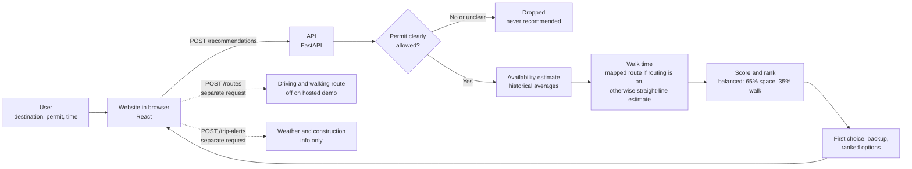
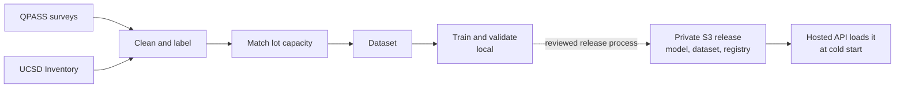
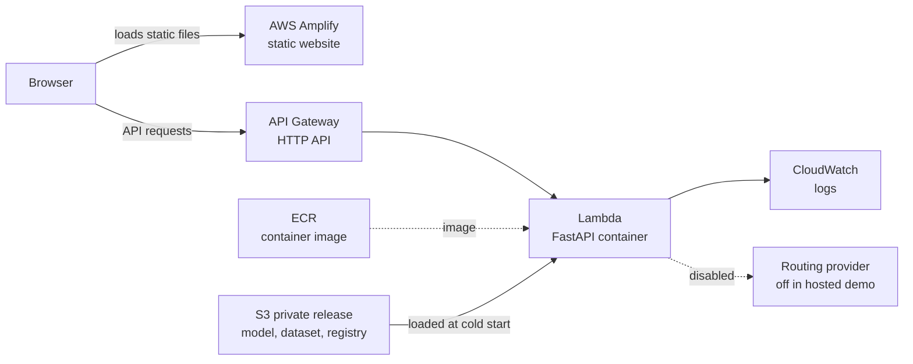

# ParkSmart

A UCSD parking recommendation tool. Enter a destination, permit type, and arrival time, and ParkSmart recommends a first-choice lot and a backup, with walk times and a short reason for each.

**Live demo:** https://demo.d2ru7u75tkpr69.amplifyapp.com

> **Note:** Results are estimates built from past UCSD parking surveys. They are not live availability and not a guaranteed space.

## Table of Contents

1. [Overview](#1-overview)
2. [System Architecture](#2-system-architecture)
3. [Repository Structure](#3-repository-structure)
4. [Key Design Decisions](#4-key-design-decisions)
5. [Quick Start (Local)](#5-quick-start-local)
6. [Environment Configuration (.env)](#6-environment-configuration-env)
7. [Rebuilding the Data and Model (Advanced)](#7-rebuilding-the-data-and-model-advanced)
8. [Deployment](#8-deployment)
9. [API Reference](#9-api-reference)
10. [Testing and Code Quality](#10-testing-and-code-quality)
11. [Limitations and Known Issues](#11-limitations-and-known-issues)
12. [Documentation Index](#12-documentation-index)
13. [Contributing](#13-contributing)
14. [Team](#14-team)

---

## 1. Overview

| Inputs | Outputs |
| --- | --- |
| Destination | First-choice lot and backup lot |
| Permit type (A, B, S, SR, D, V) | Up to 12 ranked options with reasons |
| Arrival time | Walk time for each lot |
| (none needed) | Optional weather and construction notices |

**How a recommendation is made, in three steps:**
1. Keep only lots the permit clearly allows at that time.
2. Estimate how full each lot usually is, using historical survey data.
3. Rank lots by availability and walk time (balanced weighting: 65% availability, 35% walk).

**Website vs. API.** The public website always ranks with the balanced weighting and a 20-minute walk limit. The API also accepts a `preference` (`shorter_walk`, `balanced`, `more_availability`) and a `max_walk_minutes` limit (3 to 20). On the hosted demo, routing is off, so walk times are straight-line estimates, not mapped paths.

---

## 2. System Architecture

### 2.1 Request path

What happens when a user presses Search. Routes and trip alerts are separate requests from the browser; neither changes the ranking.



Which backend answers depends on where it runs:

| Where | App | Availability estimates |
| --- | --- | --- |
| Local (`scripts/dev.sh`) | Baseline app, `src.api.main:app` | Historical averages fitted from your local dataset at startup |
| Hosted demo (AWS Lambda) | Configured app, `src.api.saved_model:create_configured_app` | Approved saved model from a private S3 release |

### 2.2 Offline data pipeline

Runs before launch, never per request. Training on your machine does not publish anything; a model reaches the hosted API only through the reviewed release process ([model storage](docs/model_storage.md)).



### 2.3 Hosting



---

## 3. Repository Structure

```text
parksmart/
├── src/                 Python backend (module guide below)
│   ├── api/             FastAPI app, schemas, Lambda entry point
│   └── trip_alerts/     Weather and construction notices
├── frontend/            React website (one-way copy, do not edit here)
├── tests/               Pytest suite, mostly one test file per module
├── infra/               AWS SAM template and Dockerfiles
├── config/              Location registry and label decisions
├── scripts/             dev.sh, check.sh, build_site.sh, sync_frontend.sh
├── docs/                Detailed guides (see Section 12)
├── notebooks/           Data exploration
├── results/, models/    Generated outputs (git-ignored, except a few small reports)
└── .env.example         Configuration template
```

### Module guide

| Area | Files in `src/` | Purpose |
| --- | --- | --- |
| API | `api/main.py`, `schemas.py`, `saved_model.py`, `settings.py`, `lambda_handler.py` | Routes, validated inputs and outputs, model loading, config, AWS entry point |
| Decision engine | `eligibility.py`, `availability.py`, `ranking.py`, `recommender.py`, `routing.py` | Permit rules, availability estimate, scoring, final pick, walk time |
| Trip alerts | `trip_alerts/` (`weather.py`, `construction.py`, `service.py`, `cache.py`) | Optional context shown beside results |
| Data pipeline | `download_qpass.py`, `download_inventory.py`, `qpass_loader.py`, `clean_inventory*.py`, `labels.py`, `capacity_*.py`, `build_dataset.py` | Download, clean, label, match capacity, build the dataset |
| Modeling | `train_availability.py`, `prediction_experiments.py`, `prepare_prediction_artifact.py` | Train, compare, and package the model |
| Analysis | `parking_analysis.py`, `parking_benchmarks.py` | Exploration and baselines |

---

## 4. Key Design Decisions

| Decision | Rationale | Tradeoff |
| --- | --- | --- |
| Historical averages, not live counts | No validated live UCSD parking feed is connected | Cannot react to today's conditions |
| Permit rules filter first | A wrong lot can mean a ticket | Lots with unclear rules are hidden |
| Balanced ranking: 65% space, 35% walk | Finding a space matters more than a short walk | The API also offers "shorter walk" and "more availability"; the website uses balanced only |
| Free routing only (OSRM or ORS) | The project must not enable paid usage | Public OSRM has no uptime guarantee; routing is off on the hosted demo |
| Alerts never affect ranking | Weather and construction are not validated signals | Shown as extra context only |
| Data preparation is offline | Fast, predictable API startup | Model updates need a rebuild and a reviewed release |

Further reading: [recommendations](docs/recommendations.md), [routing](docs/routing.md), [expert feedback](docs/expert_feedback_summary.md).

---

## 5. Quick Start (Local)

**Prerequisites**

| Tool | Version | Check |
| --- | --- | --- |
| Python | 3.11 or newer, built with OpenSSL (3.12 matches the Lambda image) | `python3.12 --version` |
| Node.js and npm | 20.19+ or 22.12+ | `node --version` |
| Git | any recent version | `git --version` |

Any Python 3.11 or newer works; the steps use `python3.12`, so swap in your version's command (for example `python3.11`) if needed. On macOS, the built-in `python3` is 3.9, which is too old. Install 3.12 with `brew install python@3.12`. Details: [Supported Python setup](docs/backend.md#supported-python-setup).

**Steps** (run from the folder you want the project in):

```bash
# 1. Get the code and install Python packages
git clone https://github.com/yraclimaco/parksmart.git
cd parksmart
python3.12 -m venv .venv
source .venv/bin/activate
python -m pip install -r requirements.txt

# 2. Download the public UCSD data and build the dataset (about 1 minute)
python -m src.download_qpass
python -m src.download_inventory
python -m src.build_dataset

# 3. Start the backend and website together (first run also installs website packages)
scripts/dev.sh
```

**Expected result**

- The terminal prints `Backend ready. Website: http://localhost:3000`.
- http://localhost:3000 opens the website, and searches return real results.
- http://127.0.0.1:8000/docs opens the API docs.
- In a second terminal, `curl http://127.0.0.1:8000/readiness` returns:

  ```json
  {"status":"ready","catalog_ready":true,"predictions_ready":true,"prediction_mode":"baseline"}
  ```

`prediction_mode` is `baseline` because `scripts/dev.sh` runs the baseline app (`src.api.main:app`), which fits historical averages from your local dataset at startup. It is not the approved saved model the hosted demo serves. To run the saved-model app locally, see [the saved-model guide](docs/issue26_handoff.md). `/health` only confirms the server is running. Ctrl+C stops both.

Optional settings (routing provider, alerts, CORS) are in Section 6.

---

## 6. Environment Configuration (.env)

ParkSmart has no `.env` loader. To use the template, copy it and load it into your shell before starting the backend. All variables are optional.

```bash
cp .env.example .env
set -a; source .env; set +a
```

| Variable | Purpose | Default |
| --- | --- | --- |
| `PARKSMART_ROUTING_PROVIDER` | `ors`, `osrm`, or `none` (no routes; walk times become straight-line estimates) | `ors` if a key is set, otherwise `osrm` |
| `ORS_API_KEY` | OpenRouteService key (free tier) | empty |
| `PARKSMART_CORS_ORIGINS` | Extra website origins allowed to call the API | localhost ports 3000 and 5173 |
| `PARKSMART_TRIP_ALERTS_ENABLED` | `false` turns off weather and construction calls | `true` |

`.env` is listed in `.gitignore`. Never commit keys, and never place one in a `VITE_` variable.

---

## 7. Rebuilding the Data and Model (Advanced)

Not needed for the quick start. These commands rebuild the dataset and retrain the model from raw public data.

**Files the default commands overwrite:**

| Command | Overwrites |
| --- | --- |
| `python -m src.download_inventory` | `results/capacity_matching/inventory_sources.csv` (download manifest; workbooks already downloaded are kept) |
| `python -m src.build_dataset` | `data/processed/pipeline/` (dataset, audit, summary), `data/interim/pipeline/capacity/` and `data/interim/inventory/` |
| `python -m src.train_availability` | `models/issue18/selected.pkl`, `models/issue18/baseline.pkl`, and `results/issue18/` (including `metadata.json`) |

Everything these commands produce is local and unreviewed. To keep your existing files, write to separate folders instead (about 2 minutes in total):

```bash
python -m src.download_qpass
python -m src.download_inventory
python -m src.build_dataset --output-dir data/processed/rebuild \
    --capacity-dir data/interim/rebuild-capacity --inventory-dir data/interim/rebuild-inventory
python -m src.train_availability --dataset data/processed/rebuild/analysis_dataset.csv \
    --output-dir results/rebuild --model-dir models/rebuild
```

Rebuilding locally does not change or upload anything on AWS. The hosted demo only changes through the approved release process: [model storage and releases](docs/model_storage.md) and [deployment resources](docs/deployment_resources.md).

Guides: [pipeline](docs/pipeline.md), [capacity matching](docs/capacity_matching_summary.md), [model training](docs/issue18_predictions.md).

---

## 8. Deployment

| Component | Method | Guide |
| --- | --- | --- |
| Backend | Lambda container behind API Gateway, defined in `infra/template.yaml` | [infra/README.md](infra/README.md) |
| Website | `scripts/build_site.sh <new-id>` builds a ZIP, then upload it to Amplify | [docs/frontend_deployment.md](docs/frontend_deployment.md) |
| Resources and costs | Checklist of AWS pieces and verification steps | [docs/deployment_resources.md](docs/deployment_resources.md) |

---

## 9. API Reference

| Endpoint | Purpose |
| --- | --- |
| `POST /recommendations` | First choice, backup, ranked options, reasons |
| `POST /routes` | Driving or walking route (returns 503 on the hosted demo, where routing is off) |
| `POST /trip-alerts` | Weather and construction notices |
| `GET /locations` | Parking locations |
| `GET /health`, `GET /readiness` | Server running, model loaded |

`/recommendations` returns a `status` of `ready`, `no_suitable_location`, or `predictions_unavailable`. Example requests and responses: [docs/examples/](docs/examples/). Full contract: [docs/backend.md](docs/backend.md).

---

## 10. Testing and Code Quality

```bash
scripts/check.sh
```

This runs backend tests, website tests, the type check, and the build. The last line should read "All checks passed".

- `tests/` mostly has one test file per module (for example, `test_ranking.py` covers `ranking.py`).
- A manual GitHub Actions workflow, "Prediction validation", rebuilds the dataset and validates the model on a clean runner.
- `.gitignore` excludes environment files, raw and processed data, trained models, and AWS build output.

---

## 11. Limitations and Known Issues

| Issue | Impact |
| --- | --- |
| Estimates only, no live counts | A lot marked likely open can still be full |
| Surveys mostly cover the first weeks of each quarter, and some quarters are missing | Accuracy on later quarters is not validated |
| Winter 2025-26 workbook excluded by team decision | Less recent data |
| Fall 2026-27 has no Inventory workbook | Capacity relies on QPASS alone |
| Hosted demo has routing off | Walk times are straight-line estimates, not mapped paths, and the drive time shows "Not available right now" |
| Website planner has no ranking controls | Every website search uses balanced ranking and a 20-minute walk limit; other preferences and limits are API-only |
| First search after a long idle period is not verified to finish within the website's 20 second timeout | Possible slow first load |
| API ranking presets other than "balanced" are starting values, not tuned | Weights may change |
| Hosted trip alerts: freshness and failure states not yet verified on AWS | Alert behavior on the demo is unconfirmed |
| Permit and location mappings still need review | Some eligibility results may change |
| Fall 2026 data and model update not yet integrated | The hosted demo still uses the existing approved model and dataset |
| Live counts, visitor pricing, and entrance photos are not built | Out of scope for this version |

---

## 12. Documentation Index

| Topic | Guides |
| --- | --- |
| Data pipeline | [pipeline](docs/pipeline.md), [QPASS schema](docs/qpass_schema_audit.md), [inventory audit](docs/inventory_audit.md) |
| Labels and capacity | [label decisions](docs/issue3_label_decisions.md), [capacity matching](docs/capacity_matching_summary.md) |
| Model | [predictions](docs/issue18_predictions.md), [experiments](docs/issue27_predictions.md), [storage](docs/model_storage.md) |
| Rules and ranking | [eligibility and ranking](docs/recommendations.md) |
| API and routing | [backend](docs/backend.md), [routing](docs/routing.md), [trip alerts](docs/trip_alerts.md) |
| Deployment | [infra](infra/README.md), [website hosting](docs/frontend_deployment.md), [resources](docs/deployment_resources.md) |

---

## 13. Contributing

1. Track work in a GitHub Issue and branch from `main`.
2. Run `scripts/check.sh` before opening a pull request.
3. Open a PR with a clear title. Only the mentor merges.
4. Do not edit `frontend/` in this repo. It is a one-way copy of [ParkSmart-Website](https://github.com/dylanwang-main/ParkSmart-Website). Change that repo, merge, then run `scripts/sync_frontend.sh`.

Conventions: [AGENTS.md](AGENTS.md).

## 14. Team

DS3 Fall 2026 project by Dylan, Vivaan, Hanrong, and Daira. Mentor: Yra Climaco.
