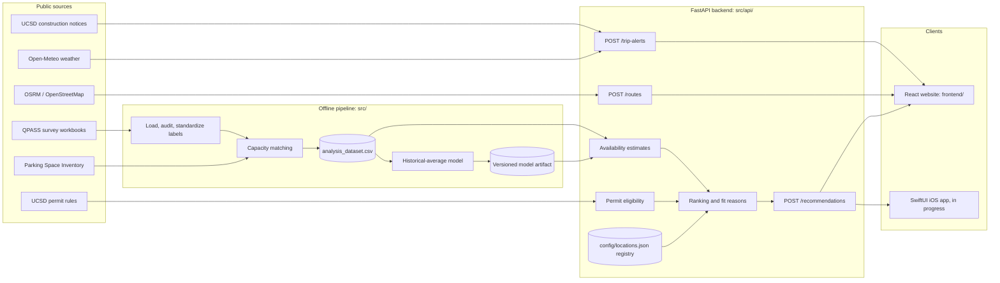
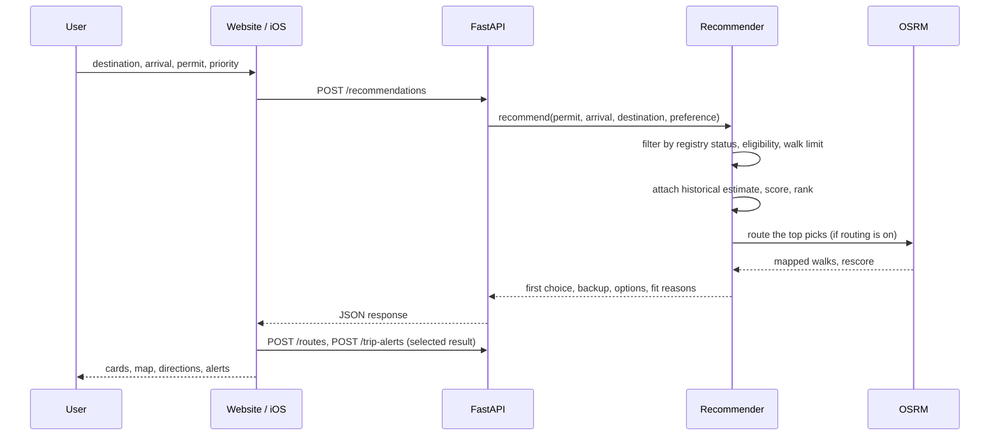

# ParkSmart design document

Status as of November 17, 2026. This describes what is built and deployed. Items
that are not finished are marked as such; nothing here claims live parking data.

## Overview

ParkSmart is a UCSD parking decision engine. A user enters where they are going,
when they will arrive and which permit they hold. ParkSmart returns a first
choice and a backup parking location, each with an expected availability, a
walking time and a short reason it ranks where it does.

It is a data science and software project, not a research model. The core is a
forecast of how full each lot usually is, built from UCSD's public QPASS
parking surveys and Parking Space Inventory reports, combined with permit
eligibility rules and walking distance. The same FastAPI backend serves a React
website and a SwiftUI iOS app, and it is deployed on AWS for the demo. The iOS app is still in progress.

## Customer identification and problem statement

**Who:** UCSD students, staff and visitors who drive to campus. The main user is
a permit holder (A, B, S, SR, D or V) who has to pick between dozens of lots and
structures that each allow different permits at different times.

**Problem:** Permit rules differ by lot, time of day and weekend, and lots fill
at different rates. Drivers often circle or park far away because they do not
know which lots they may use or how full those lots usually are at their
arrival time. UCSD publishes the rules and survey counts, but not a single
answer for "where should I park for a 10 AM class".

**Success looks like:**

- A user gets a first choice and a distinct backup in one search.
- Every recommended location is one the user's permit may use at arrival.
- Availability is described honestly as a past-survey pattern, never as a
  guarantee or a live count.
- The result explains the trade-off between walking time and availability.

## Background research and related work

The team did not build on a published model. The inputs and checks came from:

- **UCSD QPASS workbooks and Parking Space Inventory reports:** the only
  detailed public source of parking counts and capacities. They mostly cover the
  start of each quarter, which limits how far the forecast can be trusted.
- **UCSD Transportation permit pages and notices:** the source of the permit
  rules in `src/eligibility.py`, collected in the team's "UCSD Parking Domain
  Research" document and rechecked October 28, 2026.
- **Domain experts (November 6, 2026 meeting):** Ellen Schwartz (UCLA Center for
  Parking Policy) and Jonathan Wicks (Walker Consultants). Their advice shaped the
  interface: prominent walking time, color-coded availability worded as past
  patterns, and a control to trade walking against availability. What was
  adopted and what was not is in `docs/expert_feedback_summary.md`.
- **OpenStreetMap routing (OSRM / OpenRouteService), Open-Meteo, and UCSD's
  published construction notices:** external sources for walking routes, forecast
  weather and construction alerts.

## Goals

1. Recommend a first choice and backup parking location from permit, arrival
   time and destination.
2. Forecast typical availability per lot from the surveys, and evaluate that
   forecast honestly against held-out data.
3. Support every parking location whose name, capacity and category can be
   recovered reliably from the public data, and flag the rest.
4. Share one backend between the website and the iOS app.
5. Deploy a working demo on AWS with documented, repeatable steps.
6. Let users trade walking time against availability, and explain each result.

## Non-goals

- **Live availability.** No live occupancy feed was available. The planner keeps
  working on historical data, and the interface says so.
- **Pricing for visitors and daily-pay parking,** photos of structure entrances,
  and per-level permit information (not reliably recoverable from the data).
- **Guarantees.** Percentages are the share of spaces open in past surveys, not a
  chance of finding a space.
- **Official UCSD status.** ParkSmart is an unofficial student project.
- **Weather or construction changing the ranking.** Alerts are informational and
  never change predictions, eligibility or order.

## System architecture



**Components**

| Component | Where | Role |
| --- | --- | --- |
| Data pipeline | `src/qpass_loader.py`, `src/build_dataset.py`, `src/run_capacity_matching.py` | Turns survey and inventory workbooks into one audited analysis dataset. |
| Location registry | `config/locations.json`, `src/location_registry.py` | Stable `location_id`, coordinates and status for each parking location. Only `supported` locations are recommended. |
| Availability model | `src/availability.py`, `src/availability_prediction.py` | Attaches a historical-average estimate to each candidate for an arrival time. |
| Eligibility | `src/eligibility.py`, `src/ucsd_calendar.py` | Returns `allowed`, `not_allowed` or `needs_verification` for permit, parking group and time. |
| Ranking | `src/ranking.py`, `src/recommender.py` | Filters, scores and orders candidates; builds the first choice, backup, ranked options and reasons. |
| API | `src/api/` | Pydantic v2 schemas and endpoints; one `Recommender` is loaded once per process. |
| Routing | `src/routing.py` | Walking and driving routes from OSRM or OpenRouteService; keys stay on the backend. |
| Trip alerts | `src/trip_alerts/` | Forecast weather and construction notices for a trip, cached and bounded. |
| Website | `frontend/` (synced copy of ParkSmart-Website) | React + TypeScript + MapLibre interface. |
| Deployment | `infra/`, `amplify.yml`, `docs/deployment_resources.md` | Lambda behind API Gateway, S3 model storage, Amplify hosting. |

There is no database. State lives in three read-only files loaded at startup:
the registry JSON, the processed analysis CSV and the saved model artifact.

### Data model

| Object | Key fields |
| --- | --- |
| Observation (analysis dataset row) | facility, category, subtype, level, survey date and time, open spaces, selected capacity, `fraction_available`, source file/sheet/row |
| Location (registry) | `location_id`, name, standardized dataset facilities, coordinates, `registry_status` (supported, restricted, unresolved, excluded) |
| Recommendation request | destination (name, coordinates), arrival time, permit type, optional `preference` and `max_walk_minutes` |
| Recommendation response | status, first choice, backup, ranked `options` (each with `rank`, walking time and its source, `fit_reason`), explanation, limitations |

The registry currently holds 87 locations: 46 supported, 18 restricted, 22
unresolved and 1 excluded.

## Data sources

| Source | Use | Known issues |
| --- | --- | --- |
| QPASS workbooks | Dated survey counts of open spaces | Mostly the first two weeks of each quarter; several quarters missing from the public archive; one workbook (Winter 2025-26) excluded by team decision. |
| Parking Space Inventory | Capacity fallback and cross-check | Category scope can differ from QPASS; legacy summaries are unverified and never override QPASS. |
| Permit rules | Eligibility | Special permits, accessible placards and posted closures are not modeled. |
| OSRM public servers / OpenRouteService | Walking routes | Public OSRM is for light use and rate limited; the hosted demo has routing off. |
| Open-Meteo, UCSD construction layers | Trip alerts | Forecasts reach about two weeks; construction update frequency and completeness are unverified. |

Raw workbooks are public data, are never edited and are not committed.
Occupancy summary reports are not used as training observations. Details:
`docs/pipeline.md`, `docs/inventory_audit.md`, `docs/qpass_observation_contract.md`.

## Execution flow

**Offline (reproducible from the repository root):**

```bash
python -m src.download_qpass        # workbooks -> data/raw/QPASS/
python -m src.download_inventory
python -m src.build_dataset         # audited analysis_dataset.csv
python -m src.train_availability    # compare models, save the selected artifact
```

1. Load every workbook, reshape to one observation per reading and validate.
2. Standardize facility and category labels without merging uncertain ones.
3. Select a capacity per reading (QPASS first, same-quarter Inventory only as a
   documented fallback) and compute `fraction_available`.
4. Join, deduplicate and apply inclusion rules. The build re-reads its outputs
   and fails if rows were lost or multiplied.
5. Fit and compare predictors on expanding whole-date validation folds, then
   save the selected one as a versioned artifact.

**Per request (online):**



Ranking in short: a candidate must be a supported location, allowed for the
permit at arrival, within the walking limit (default 20 minutes) and have an
estimate. Its score is `a x availability + w x walk score`, where the weights
come from the user's priority (balanced 0.65/0.35, shorter walk 0.20/0.80, more
space 0.85/0.15). Full rules: `docs/recommendations.md`.

## Design rationale and trade-offs

| Decision | Why | Cost |
| --- | --- | --- |
| **Historical averages instead of a regression model.** | On requests the service can answer, averages beat linear, ridge, random forest and gradient boosting on validation (MAE 18.05 vs 18.22 for the best regression, near-full MAE 12.25 vs 14.22; `docs/issue18_predictions.md`). Issue #27 tried recency-weighted averages and they made near-full error worse, so averages stayed. | Simple model; no seasonal or event signal. |
| **Return no estimate when history is missing.** | A guessed number would look like data. Unsupported groups, times and calendars stay unknown. | Only about 57% of validation readings are supported. |
| **Conservative eligibility.** | Unknown, conflicting or specialized rules are `needs_verification` and never recommended. A wrong "you can park here" costs the user a ticket. | Some valid options are withheld, including on university holidays. |
| **Stable registry IDs instead of name matching.** | Names and labels change across years; IDs let the website, model and iOS app agree on a place. | Maintaining the registry is manual. |
| **One shared backend.** | Website and iOS reuse the same scoring and explanations, so behavior cannot drift. | Both clients depend on one API contract (`docs/api_proposal.md`). |
| **Alerts in a separate endpoint.** | A weather or construction failure cannot block a parking search, and alerts cannot alter ranking. | One extra request per selected result. |
| **Public routing servers with a throttle.** | No paid key required; routes degrade to labeled straight-line estimates when unavailable. | Rate limits; routing is off in the hosted demo. |
| **Preference weights are starting points.** | They give users a useful control now. | The two non-default weightings are untuned and need review with experts. |
| **Synced `frontend/` copy and manual Amplify ZIP deploys.** | Keeps the website editable in its own repo, and GitHub app authorization for Amplify was not available. | Updates need a sync and an upload step (`docs/frontend_deployment.md`). |

## Evaluation

- **Forecast:** three expanding whole-date validation folds on 59,979
  development readings, with the latest 16,123 readings (from 2025-10-08) held
  out. Model selection used only supported validation rows and identical row
  IDs for every candidate. Honest caveat: the holdout was inspected earlier, so
  these are exploratory comparisons, not a fresh test of future accuracy.
- **Weak spots we measured:** visitor lots overstate availability by about 24
  percentage points when nearly full; sparse groups (1-19 dates of history) are
  the least reliable (`docs/issue27_predictions.md`).
- **Software:** over 1,100 backend tests (eligibility rules, ranking, schemas,
  routing, alerts, deployment helpers) and 225 website tests, plus type checks
  and the DS3 code-review pass before each PR. Hosted checks (routes, alerts
  and failure states on AWS) are tracked in `docs/deployment_resources.md`.

## Security and configuration

- **Secrets:** none are committed. `.env` is gitignored and `.env.example`
  documents the template. The only optional key, `ORS_API_KEY`, stays on the
  backend.
- **Website variables:** `VITE_API_BASE_URL` and `VITE_RECOMMENDATION_SOURCE` are
  copied into public JavaScript at build time and must never hold a secret.
- **Backend settings:** `PARKSMART_*` environment variables (model mode, artifact
  and dataset paths, CORS origins, routing provider, alerts switch). CORS
  accepts only exact, listed origins.
- **Model files:** artifacts are loaded only from trusted paths, with exact
  library-version checks; no endpoint accepts uploaded pickles or S3 URLs.
- **AWS:** private S3 bucket with Block Public Access, role-based access using
  roles managed by the mentor, API throttling (rate 1, burst 2), Lambda
  concurrency and timeout limits, seven-day logs and no provisioned
  concurrency. Spending is reviewed by the account owner.
- **Dependencies:** pinned in `requirements.txt` and `frontend/package.json`.

## Risks and mitigations

| Risk | Mitigation |
| --- | --- |
| Survey data covers little beyond the start of each quarter, so the forecast may not hold later in the term. | Say so in the interface and docs; label estimates that borrow another time; never fill gaps. |
| Users read a percentage as a guarantee. | Wording is always "usually open", "past surveys"; a limitations section and FAQ say it is not live or guaranteed. |
| Permit rules change or are misread. | Rules cite their sources and check date; uncertain cases are `needs_verification`; tests cover each rule and boundary. |
| Public routing or weather services are slow or down. | Bounded timeouts, caches, labeled fallbacks; the planner works without them. |
| First request after idle is slow on Lambda. | Documented as unverified against the website's 20-second timeout; the website shows a retry. |
| Cloud spending. | Demo-sized limits, a documented resource inventory and an owner billing review. |
| A stale or broken deploy (for example after a redeploy). | The website shows a reload button if the planner fails to load; the deploy steps and checklist are documented. |
| Locations with unresolved names or capacities. | They stay `unresolved` or `restricted` in the registry and are never recommended. |

## Rollout plan

1. **Validate:** run the full test suite and the mentor's DS3 code-review skill
   before every PR; another teammate reviews or tests when possible; only the
   project mentor merges.
2. **Deploy the demo:** backend as a Lambda container behind API Gateway;
   website as a manual ZIP upload to the existing Amplify app. Steps and the
   verification checklist are in `infra/README.md` and
   `docs/frontend_deployment.md`.
3. **Verify on the hosted site:** a Geisel Library search with an S permit,
   Saturday and failure states, plus a first search after idle.
4. **Hand off:** `AGENTS.md` and `docs/` describe setup, commands and
   conventions so a new contributor or agent can continue the work.
5. **Extend:** enable hosted routing, finish and verify trip alerts on AWS, add
   live parking-status data only if UCSD grants access, and revisit preference
   weights and the forecast with the domain experts.
